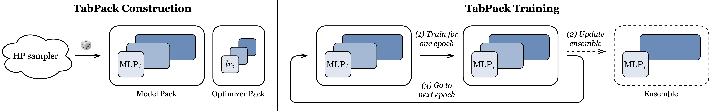

# TabPack & TabPackage

This is the official repository and Python package for the paper "TabPack: Efficient Hyperparameter Ensembles for Tabular Deep Learning" ([arXiv](https://arxiv.org/abs/2607.05380)).
TabPack provides:

**1. An effective and practical baseline** for supervised learning on medium-to-large tabular datasets.
It achieves competitive out-of-the-box performance on benchmarks and is efficient enough to get started on a modern MacBook.

**2. An efficient way to train and ensemble many MLPs with different hyperparameters** for fast experiments.
Train hundreds or thousands of MLPs and build many ensembles in one run.

# TL;DR



As a predictive tabular model, **TabPack is an efficient ensemble of MLPs with different model and optimizer hyperparameters**.
In a single run, TabPack samples and trains many MLPs with different hyperparameters efficiently in parallel and builds ensembles on the fly during training.
See the paper for details.

**TabPack is designed to be a good starting point for solving tabular ML tasks** on medium-to-large datasets:

- **Competitive out-of-the-box performance.**
  The results reported in the paper are achieved with zero hyperparameter tuning.
- **Better performance with less compute.**
  On a modern MacBook, training TabPack once and achieving good performance can be faster than tuning other baselines on GPUs.
- **Practical for deployment.**
  A trained TabPack is just an ensemble of MLPs that will meet efficiency requirements in many real-world applications.

Overall, **TabPack can reduce the time, compute, and tuning effort** needed to obtain a good tabular-learning baseline.

# TabPackage

> [!WARNING]
> The package should be considered experimental: expect rough edges and breaking changes.

TabPackage is the PyTorch-based Python package behind TabPack.
It supports efficient parallel training and ensembling of many MLP-like models with different hyperparameters.
The main features include:

- **High-level training API for TabPack** including PyTorch and scikit-learn interfaces.
- **PyTorch building blocks**, including:
  - **Module packs** for applying layers from many models with different hyperparameters in parallel.
  - **Optimizer packs** for training module packs with different optimization hyperparameters for each member.
  - **Ensembling utilities** for constructing ensembles of models on the fly while they are training.
  - **Metric functions** for computing metrics for each pack member.

## Installation

```
pip install tabpackage

# Or, with the scikit-learn API:
pip install "tabpackage[sklearn]"
```

> [!NOTE]
> When using the MPS device on Apple Silicon with PyTorch older than 2.12, enable CPU fallback **before importing PyTorch**:
>
> ```
> import os
> os.environ["PYTORCH_ENABLE_MPS_FALLBACK"] = "1"
>
> import torch
> import tabpackage
> ```
>
> This will make the package work with a harmless warning about the CPU fallback.

## Basics

For most users, the [examples](#examples) are the recommended entry point to the package.
The following subsections provide high-level sketches of what to expect from the package.

### PyTorch training API

Use `tabpackage.train` to train TabPack on a supervised tabular-learning task with PyTorch:

```py
# Prepare datasets.
raw_datasets: dict[str, dict[str, torch.Tensor]] = {
    'train': {'x_num': ..., 'x_cat': ..., 'y': ...},
    # At least one additional split is required.
    # See the examples for details.
    'val': ...,
    ...
}
datasets = preprocess(raw_datasets)

# Train TabPack.
tabpack = tabpackage.train(datasets=datasets, ...)

# Optionally, retrain TabPack on the combined training and validation data
# for better performance.
if retrain:
    raw_datasets['train'] = {
        'x_num': torch.cat([
            raw_datasets['train']['x_num'],
            raw_datasets['val']['x_num'],
        ]),
        ...
    }
    datasets = preprocess(raw_datasets)  # Redo the preprocessing.
    tabpack = tabpackage.retrain(tabpack, ...)

# Create a predictor, which is a vanilla PyTorch module.
predictor = tabpack.make_predictor(...)

# Make predictions.
y_pred, y_pred_ensembles = predictor(x_num, x_cat)

# Export the model.
...
torch.save(predictor, ...)
torch.onnx.export(predictor, ...)
torch.export.save(torch.export.export(predictor, ...), ...)
```

### scikit-learn API

Use `tabpackage.sklearn` to train TabPack with a scikit-learn interface:

```py
from tabpackage.sklearn import TabPackClassifier, TabPackRegressor

# Prepare datasets.
X_train, y_train = ...
X_val, y_val = ...
X_test = ...

# Train TabPack.
tabpack = TabPackClassifier(...)  # Or TabPackRegressor(...).
# The extra dataset split is required. See the examples for details.
tabpack.fit(X_train, y_train, extra_set=(X_val, y_val))

# Optionally, retrain TabPack on the combined training and validation data
# for better performance.
if retrain:
    X_full, y_full = ...  # Merge train + val and redo data preprocessing.
    tabpack.refit(X_full, y_full)

# Make predictions.
y_pred = tabpack.predict(X_test)
y_proba = tabpack.predict_proba(X_test)  # Classification only.
```

## API Overview

The package is designed to be easy to learn from well-documented [examples](#examples) and code.
A high-level summary:

- **`tabpackage.train` is the central function of the package.**
  Everything else either uses `tabpackage.train` or is used by `tabpackage.train`.
- `tabpackage.sklearn` provides scikit-learn estimators that are thin wrappers around `tabpackage.train`.
- The remaining components provide building blocks for implementing TabPack-like systems.

## Examples

- [`examples/tabpack.py`](./examples/tabpack.py) is a well-documented end-to-end example covering TabPack training and export.
- [`examples/tabpack_sklearn.ipynb`](./examples/tabpack_sklearn.ipynb) ([Colab](https://colab.research.google.com/github/yandex-research/tabpack/blob/main/examples/tabpack_sklearn.ipynb)) showcases scikit-learn API for TabPack.
- `tabpackage._training` is the reference TabPack training implementation that can be copied and customized as needed.
- The following classes form a good set of examples showing how to implement module packs:
  - `tabpackage.nn.DropoutPack`: a pack of dropout layers with different dropout rates.
  - `tabpackage.nn.LinearPack`: a pack of linear layers with different input and output sizes.
  - `tabpackage.nn.MLPBackbonePack`: a pack of MLP backbones with different depth, width and dropout rates.
  - `tabpackage.nn.TabPack`: a pack of full-fledged tabular MLPs with different hyperparameters.
    Pay extra attention to the use of `tabpackage.nn.PackView` in this module.

# How to cite

```
@inproceedings{gorishniy2026tabpack,
    title={{TabPack: Efficient Hyperparameter Ensembles for Tabular Deep Learning}},
    author={Yury Gorishniy and Akim Kotelnikov and Ivan Rubachev and Artem Babenko},
    booktitle={ICML},
    year={2026},
}
```
